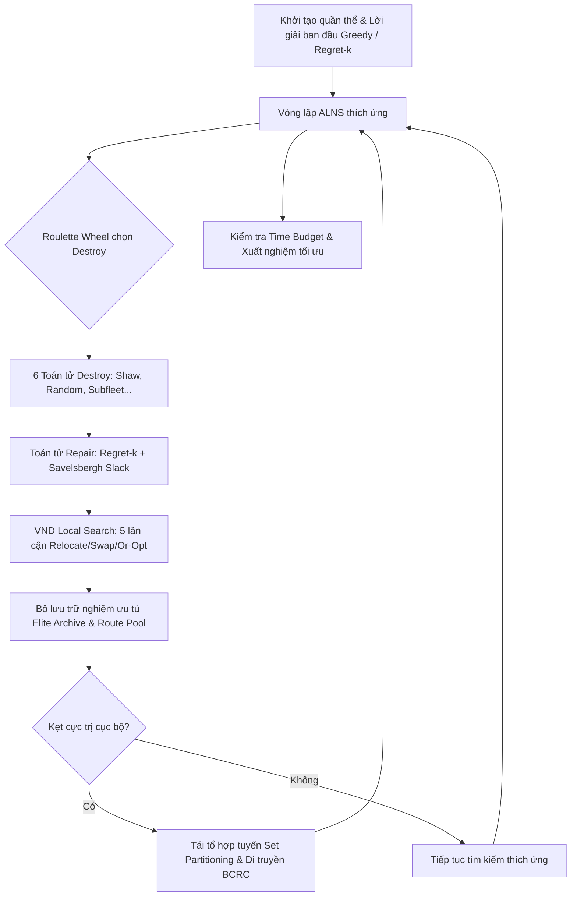

# BÁO CÁO BÀI TẬP LỚN PROJECT 1: VEHICLE ROUTING PROBLEM (VRP)
## Đề tài: Share-a-Ride Problem (SARP) - Tối Ưu Hóa Định Tuyến Xe Ghép Chở Khách Và Giao Hàng

---

## 📌 1. Thông Tin Sinh Viên & Đề Tài

* **Họ và tên sinh viên:** Quảng Kiệt *(Cập nhật theo thông tin chính thức của bạn)*
* **Mã số sinh viên (MSSV):** `2021xxxx` *(Điền MSSV vào đây)*
* **Lớp:** Kỹ thuật Phần mềm / Khoa học Máy tính - ĐHBK Hà Nội (HUST - SOICT)
* **Giảng viên hướng dẫn / chấm điểm:** Thầy Nguyễn Quang Tuấn
* **Repository Git:** [https://gitlab.nqtuan0192.me/KietQuangTT/project1-vrp](https://gitlab.nqtuan0192.me/KietQuangTT/project1-vrp)

---

## 📖 2. Mô Tả Bài Toán (Problem Description)

**Share-a-Ride Problem (SARP)** là một biến thể hiện đại và phức tạp của bài toán định tuyến phương tiện (Vehicle Routing Problem - VRP), kết hợp giữa **Dial-a-Ride Problem (DARP)** và **Pickup and Delivery Problem with Time Windows (PDPTW)**. 

Hệ thống điều phối một đội gồm $K$ phương tiện (taxi) xuất phát từ các trạm (depot) khác nhau để phục vụ đồng thời hai loại nhu cầu:
1. **Hành khách (Passengers):** Cần đón tại điểm $p$ và trả tại điểm $d$. Nhằm đảm bảo trải nghiệm khách hàng, xe đón khách sẽ chở thẳng từ $p$ đến $d$ (không chở chung hai nhóm khách cùng một lúc).
2. **Bưu kiện / Hàng hóa (Parcels):** Cần lấy tại điểm $p$ và giao tại điểm $d$, chiếm tải trọng $w$. Bưu kiện có thể được vận chuyển chung trong xe cùng với hành khách hoặc các bưu kiện khác, miễn là tổng tải trọng không vượt quá sức chứa của xe.

```
       [Depot Xe k]
            │
            ▼
    (Lấy Hàng 1: w1) ──► (Đón Khách 1) ──► (Trả Khách 1) ──► (Giao Hàng 1)
                                                                 │
                                                                 ▼
                                                          (Chuyến tiếp theo...)
```

### 🎯 Mục tiêu tối ưu
Tối đa hóa **Tổng Lợi Nhuận (Total Profit)** của toàn hệ thống:
$$\max \text{Profit} = \sum_{r \in \text{Served}} \text{Revenue}(r) - \sum_{k=1}^{K} \text{TravelCost}(k)$$

### ⚠️ Các ràng buộc (Constraints)
* **Ràng buộc sức chứa (Capacity):** Tại bất kỳ thời điểm nào, tổng khối lượng hàng trên xe $k$ không vượt quá dung lượng $C_k$.
* **Cửa sổ thời gian (Time Windows):** Mọi thao tác đón/trả phải bắt đầu trong khoảng $[e, l]$. Nếu xe đến trước $e$, xe phải đợi đến $e$; xe không được phép đến sau $l$.
* **Ràng buộc thứ tự (Precedence):** Với bưu kiện, thao tác lấy hàng ($p$) luôn phải diễn ra trước thao tác giao hàng ($d$).
* **Thời gian phục vụ (Service Duration):** Mỗi thao tác đón/trả/bốc xếp mất một khoảng thời gian cố định $s_t$.
* **Giới hạn thời gian tính toán (Time Budget):** Thuật toán tự động quản lý thời gian để xuất nghiệm tốt nhất khi hết giờ (mặc định 285s).

---

## 🧠 3. Thuật Toán & Kiến Trúc Giải Thuật

Dự án áp dụng mô hình **Hybrid Metaheuristic** kết hợp đa tầng:



### 3.1. Adaptive Large Neighborhood Search (ALNS)
Thuật toán phá hủy và tái tạo thích ứng, tự động học và điều chỉnh xác suất chọn các toán tử thông qua cơ chế bánh xe Roulette (Roulette Wheel):
* **6 Toán tử Destroy (Phá hủy):**
  1. *Random Destroy:* Loại bỏ ngẫu nhiên các yêu cầu để tăng tính đa dạng.
  2. *Shaw / Spatio-Temporal Destroy:* Loại bỏ các yêu cầu có độ liên quan cao về không gian và thời gian.
  3. *Single-Route Cluster Destroy:* Làm trống một cụm tuyến đường của một xe để tái phân bổ.
  4. *Worst Net-Gain Destroy:* Loại bỏ các yêu cầu có tỉ suất lợi nhuận ròng thấp nhất.
  5. *Time-Window Proximity Destroy:* Loại bỏ các điểm có cửa sổ thời gian gần nhau.
  6. *Multi-Vehicle Sub-Fleet Destroy:* Phá hủy liên tuyến trên 2-3 xe hoạt động trong cùng khu vực địa lý.
* **Toán tử Repair (Khôi phục):**
  * Áp dụng **Regret-k Heuristic** ($k = 1, 2, 3$) kết hợp công thức cắt tỉa thời gian **Savelsbergh Forward Slack** để tính toán kiểm tra khả thi chỉ trong $O(L^2)$ thay vì duyệt toàn bộ chuỗi.
  * Tích hợp cơ chế nhiễu ngẫu nhiên (noise factor) và kiểm soát khoảng cách (alpha penalty) để thoát bẫy cục bộ.

### 3.2. Variable Neighborhood Descent (VND)
Sau mỗi phân đoạn hoặc khi tiệm cận nghiệm tốt, thuật toán kích hoạt tìm kiếm cục bộ sâu với 5 cấu trúc lân cận:
* **Or-Opt:** Di chuyển phân đoạn liên tiếp.
* **Intra-Route Relocate:** Tối ưu lại thứ tự đón trả trong cùng một xe.
* **Inter-Route Relocate:** Chuyển giao yêu cầu giữa các xe lân cận.
* **Route Swap:** Hoán đổi chéo yêu cầu giữa hai xe.
* **Ejection Chain & Pruning:** Loại bỏ các chặng gây giảm lợi nhuận ròng.
* Tích hợp **Don't-Look bits** để bỏ qua những đỉnh không có khả năng cải thiện, tăng tốc độ xử lý gấp nhiều lần.

### 3.3. Set Partitioning Route Assembly & BCRC Genetic Crossover
* **Elite Route Pool:** Duy trì một kho lưu trữ các lộ trình xe đơn lẻ có lợi nhuận cao (được lập chỉ mục bằng bitmask nhị phân).
* **Beam-Search Set Packing:** Định kỳ giải bài toán phủ tập hợp (Set Partitioning) để ghép các tuyến tốt nhất của các xe độc lập lại với nhau.
* **BCRC (Best Cost Route Crossover):** Lai ghép di truyền lời giải từ các cha mẹ ưu tú khi quá trình tìm kiếm bị đình trệ (stagnation).

---

## 💻 4. Yêu Cầu Môi Trường & Thư Viện

* **Ngôn ngữ:** Python 3.10 / 3.11 / 3.12 / 3.13.
* **Tính tương thích:** Mã nguồn chính `main.py` được tối ưu hóa hoàn toàn bằng **Python Standard Library** (các thư viện có sẵn trong Python như `sys`, `math`, `time`, `random`, `argparse`, `signal`). Do đó, Thầy giáo có thể **chạy ngay lập tức mà không cần cài đặt thêm bất kỳ thư viện ngoài nào**.
* Để phục vụ vẽ biểu đồ hoặc phân tích chuyên sâu (tùy chọn), có thể cài đặt:
  ```bash
  pip install -r requirements.txt
  ```

---

## 🚀 5. Hướng Dẫn Chạy Chương Trình

Chương trình hỗ trợ đầy đủ các hình thức truyền tham số dòng lệnh:

### 5.1. Chạy thử nghiệm nhanh (Quick Test)
> [!TIP]
> Mặc định chương trình chạy trong **285 giây** (thời gian ngân sách chuẩn khi chấm thi môn học). Khi Thầy hoặc sinh viên muốn chạy thử nghiệm nhanh kiểm tra kết quả ngay trong vài giây, hãy truyền thêm cờ `--time-limit 2` hoặc `--time-limit 5`:

```bash
# Chạy nhanh với bộ test bất kỳ (ví dụ sample_01.txt)
python main.py --time-limit 2 data/sample_01.txt

# Chạy nhanh và lưu kết quả ra file output.txt
python main.py --time-limit 5 data/sample_02.txt output.txt
```

### 5.2. Chạy chấm điểm chính thức (Full Budget 285s)
```bash
# Chạy với ngân sách thời gian mặc định (285 giây)
python main.py data/sample_01.txt

# Chạy và xuất kết quả ra file
python main.py data/sample_01.txt output.txt
```

### 5.3. Chạy qua chuyển hướng luồng dữ liệu (Standard Input Redirection)
```bash
python main.py --time-limit 5 < data/sample_01.txt
```

### 5.4. Tùy chỉnh tham số dòng lệnh (`--time-limit` và `--seed`)
```bash
python main.py --time-limit 30 --seed 2026 data/sample_03.txt output.txt
```

---

## 📊 6. Cấu Trúc Dữ Liệu Đầu Vào / Đầu Ra (I/O Format)

### 6.1. Định dạng Dữ liệu Đầu vào (Input)
Dữ liệu đầu vào gồm các số nguyên phân tách bởi khoảng trắng hoặc dấu xuống dòng:

1. **Dòng 1:** `K N M`
   * $K$: Số lượng xe taxi.
   * $N$: Số lượng yêu cầu hành khách.
   * $M$: Số lượng yêu cầu bưu kiện.
   * Tổng số đỉnh trong mạng lưới: $V = K + 2N + 2M$.
2. **$K$ dòng tiếp theo:** Thông tin về từng xe $k$:
   * `depot_k capacity_k`: Đỉnh xuất phát (trạm) và sức chứa tối đa của xe $k$.
3. **$N$ dòng tiếp theo:** Thông tin về từng hành khách $i$:
   * `p d e_t l_t s_t rev`
   * `p`, `d`: Đỉnh đón và đỉnh trả.
   * `e_t`, `l_t`: Thời điểm sớm nhất đón và muộn nhất trả.
   * `s_t`: Thời gian phục vụ đón/trả.
   * `rev`: Doanh thu thu được khi phục vụ.
4. **$M$ dòng tiếp theo:** Thông tin về từng bưu kiện $j$:
   * `p d w ep lp ed ld s_t rev`
   * `p`, `d`: Đỉnh nhận hàng và đỉnh giao hàng.
   * `w`: Trọng lượng của bưu kiện.
   * `ep`, `lp`: Cửa sổ thời gian nhận hàng.
   * `ed`, `ld`: Cửa sổ thời gian giao hàng.
   * `s_t`: Thời gian bốc xếp hàng.
   * `rev`: Doanh thu khi hoàn thành giao hàng.
5. **Ma trận thời gian di chuyển ($V \times V$):**
   * $V$ dòng, mỗi dòng $V$ số nguyên: `travel_time[u][v]` là thời gian đi từ $u$ tới $v$.
6. **Ma trận chi phí di chuyển ($V \times V$):**
   * $V$ dòng, mỗi dòng $V$ số nguyên: `travel_cost[u][v]` là chi phí đi từ $u$ tới $v$.

### 6.2. Định dạng Dữ liệu Đầu ra (Output)
* **Dòng 1:** Một số nguyên duy nhất là **Tổng lợi nhuận (Total Profit)** lớn nhất tìm được.
* **$K$ dòng tiếp theo:** Tuyến đường phục vụ của từng xe từ $1$ đến $K$:
  * Bắt đầu bằng $L$ (số đỉnh ghé thăm). Tiếp theo là danh sách $L$ đỉnh cách nhau bởi dấu cách: `L v_1 v_2 ... v_L`.
  * Nếu xe không phục vụ yêu cầu nào: in ra `0`.

---

## 📁 7. Cấu Trúc Thư Mục Dự Án

```
Project1-VRP/
│
├── main.py                  # Mã nguồn chính giải bài toán SARP (Hybrid ALNS + VND)
├── requirements.txt         # Khai báo các thư viện phụ trợ (numpy, matplotlib, scipy)
├── .gitignore               # Loại bỏ các file rác, bộ đệm Python, venv, log
├── README.md                # Báo cáo tổng quan hướng dẫn chấm điểm dự án
│
└── data/                    # Thư mục chứa 9 bộ test mẫu
    ├── README.md            # Tài liệu chi tiết về các bộ test
    ├── sample_01.txt        # Test 1
    ├── sample_02.txt        # Test 2
    ├── ...
    └── sample_09.txt        # Test 9
```

---

## 👨‍🏫 8. Hướng Dẫn Phân Quyền Truy Cập Cho Thầy Giáo (Nghiệm Thu)

Dự án đang được thiết lập ở chế độ riêng tư (**Private**) trên hệ thống GitLab trường. Để Thầy giáo có thể truy cập, xem mã nguồn và chấm điểm:

1. Đăng nhập vào tài khoản cá nhân trên GitLab: [https://gitlab.nqtuan0192.me](https://gitlab.nqtuan0192.me)
2. Truy cập vào kho dự án: `KietQuangTT / project1-vrp`
3. Tại thanh menu bên trái, chọn **Manage** (hoặc **Settings / Paramètres**) $\rightarrow$ **Members** (Thành viên).
4. Nhấn nút **Invite members** (Mời thành viên).
5. Nhập tên tài khoản hoặc email của Thầy giáo:
   * **Username / Email:** Tài khoản của Thầy trên GitLab trường.
   * **Role (Vai trò):** Chọn `Reporter` (Chỉ xem/chấm điểm) hoặc `Developer` (Toàn quyền đọc/thực thi).
6. Nhấn nút **Invite** để kích hoạt quyền truy cập.

---

*Chúc Thầy có trải nghiệm chạy thử nghiệm dự án thuận lợi và đạt kết quả cao!*
